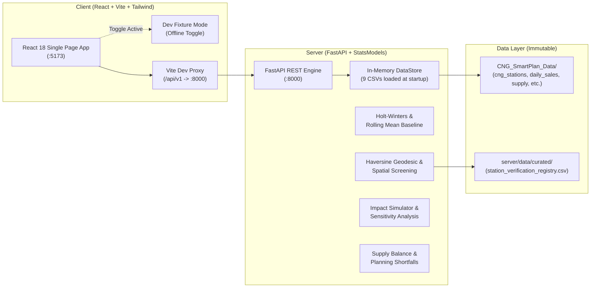

# CNG SmartPlan — Integration Runbook & Deployment Guide
**Project:** CNG SmartPlan (PS000002)  
**System:** Station-Level Demand Forecasting & Network Expansion Simulator  
**Last Updated:** November 1, 2026

---

## 1. System Architecture Overview



---

## 2. Prerequisites

- **Python:** 3.10 to 3.13 (verified on Python 3.13.7)
- **Node.js:** 18.0.0 or higher (verified on Node 18+)
- **Package Managers:** `pip` and `npm` (npm 10+)
- **OS:** Windows, Linux, or macOS

---

## 3. Step-by-Step Local Startup

### Terminal 1: Backend Service (FastAPI)
```bash
# From repository root
cd e:/CNG_SmartPlan

# Install dependencies (if not already installed)
pip install -r server/requirements.txt

# Start FastAPI application
python -m uvicorn main:app --app-dir server --host 0.0.0.0 --port 8000 --reload
```
- **Service URL:** `http://localhost:8000`
- **Interactive Swagger Docs:** `http://localhost:8000/docs`
- **Health Check:** `http://localhost:8000/api/v1/health`

### Terminal 2: Frontend Service (Vite + React)
```bash
# From repository root
cd e:/CNG_SmartPlan/client

# Install dependencies (if not already installed)
npm install

# Start Vite development server
npm run dev
```
- **Application URL:** `http://localhost:5173`
- All `/api/v1/*` requests are automatically proxied to `http://localhost:8000`.

---

## 4. Verification & Testing Commands

### 4.1 Backend Automated Tests (Pytest)
```bash
python -m pytest server/tests/ -v
```
- **Expected Result:** 73 passed in ~6 seconds.

### 4.2 Frontend Automated Tests (Vitest)
```bash
cd client
npm test
```
- **Expected Result:** 9 test files passed, 73 tests passed.

### 4.3 Static Typecheck
```bash
cd client
npm run typecheck
```
- **Expected Result:** 0 errors (`tsc --noEmit`).

### 4.4 Production Bundle Build
```bash
cd client
npm run build
```
- **Expected Result:** Builds cleanly into `client/dist/` in ~10 seconds.

### 4.5 Data Package Validation
```bash
python CNG_SmartPlan_Data/validate_package.py
```
- **Expected Result:** All 10 validation groups report PASS.

---

## 5. Offline Dev Fixture Mode

For isolated UI development or hackathon demonstration when the backend is offline:
1. Open the web app at `http://localhost:5173`.
2. Click the **"Enable Dev Fixtures"** button in the header or on the Forecast / Simulator page.
3. The app switches to offline mode with contract-compliant synthetic fixtures.
4. An amber persistent indicator will confirm: *"Dev Fixtures Active"*.
5. Click **"Switch to Live API"** at any time to reconnect to FastAPI.

---

## 6. Troubleshooting Common Issues

| Symptom | Cause | Solution |
|---|---|---|
| `[vite] http proxy error: ECONNREFUSED` | FastAPI backend is not running on port 8000 | Start the backend via `python -m uvicorn main:app --app-dir server --host 0.0.0.0 --port 8000` |
| `'vite' is not recognized as an internal command` | `node_modules` not installed | Run `npm install` inside `client/` |
| `Permission denied: .git/index.lock` | Windows file locking on `.git` | Ensure test commands do not run concurrently with git write operations |
| `Validation run date mismatch in validation_report.md` | `validate_package.py` rewrites report timestamp | Run `git checkout -- CNG_SmartPlan_Data/validation_report.md` to restore exact immutable source hash |
